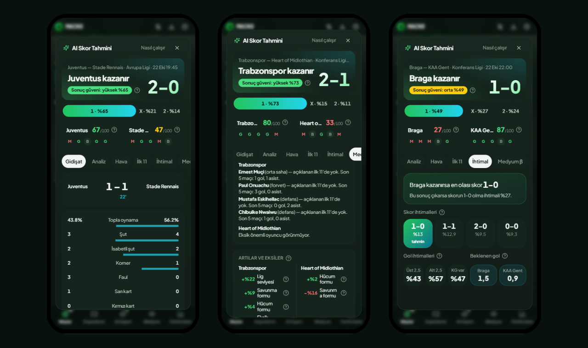

# Hi, I'm Berker

I work in product and growth and I build the products myself: live sports data dashboards, browser games and the content tools that keep a brand's channels running. I like taking an idea from a blank page to something people use every day and I care about the parts that don't show on a screenshot: data quality, fair rules and numbers I can defend.

I build mostly in TypeScript and Node.js, with React and Next.js on the front end. I pair with Claude Code daily: I set the direction and the design and I check every result before it ships.

Open to product, growth and product-minded engineering roles in gaming, sports and tech.

---

## Macko: football match intelligence

**The problem.** Pre-match information is scattered across a dozen sources, and most predictions can't say why they think what they think, or how often they turn out right.

**What Macko does.** It turns every match into one screen of evidence plus a model you can audit. I use it every day across 100+ matches a day (European leagues, UEFA competitions, the NBA), with live, upcoming and finished views and a nine-day calendar.

- **A sourced match file.** Scorers and assists, the last five results, likely absentees with a probability for each ("missed the last two matches: 94% likely out"), coach tenure, travel distance, rest days and kick-off weather. Where a source has nothing, it says "no data" instead of guessing.
- **Live match view.** Possession, shots, corners and cards as the game goes, plus starting line-ups as soon as they are announced. Mobile-first, with a built-in phone preview.
- **Two models side by side.** The first starts from the market consensus and adjusts it within tight caps for form, injuries and weather. The second, Medyum, is fully independent: a layered goal model trained on 2,543 matches that never sees market prices, then shows where it disagrees and why, factor by factor.

**Measured, not claimed.**

- The first model, tested on 290 finished matches: correct results rose from 50.7% to 55.2%, and calls marked high-confidence were right 72% of the time.
- The independent model, in a walk-forward backtest where each week is trained only on the past: no edge over the market yet (log-loss 0.990 against 0.961). The app states this on screen and keeps the model labelled beta until two to three months of live tracking say otherwise.

**Built to run unattended.** Request budgets, a circuit breaker and disk caches keep it up when a data feed fails, and model training runs in a worker thread so the dashboard never freezes.

`Next.js` `TypeScript` `Node.js worker threads` `Poisson and ridge regression` `ESPN` `FPL` `Open-Meteo` `Wikidata`

## Kutubil: daily film trivia grid ([play it](https://oyna.kutubil.workers.dev))

**Built and shipped in under 24 hours:** first commit on a Saturday evening, live on Cloudflare the next afternoon with the data pipeline and online rooms working; automated backups and a guarded deploy followed the same evening.

A daily 3×3 grid for film fans: name an actor who fits both the row and the column. Film data comes from Wikidata and TMDB, gets cleaned into six catalogues (global, Turkish film and TV, Korean, Gen-Z and a mix) and a generator builds a new grid every night. You can also challenge a friend in a live room.

`React 19` `Vite` `TypeScript` `Cloudflare Workers` `D1` `Durable Objects`

## Firing XI: fantasy transfer league (in progress)

Managers build squads and play each other in a weekly league. I wrote the simulator before the game, because the hard part isn't the screens, it's making sure the rules give every manager a fair season. Every rule change runs through hundreds of simulated seasons and 500+ tests before it reaches the game. Mobile-first, with a pitch view, kit-style player cards and drag-and-drop line-ups. The repo is private for now; happy to walk anyone through it.

`Node.js` `JavaScript` `CSS` `Headless browser testing`

---

## AI-powered automation and brand systems

I build automation that takes repetitive work off people's plates: agents that research and write, pipelines that collect and clean data and template systems that keep every output on-brand. Some examples:

- **Brand systems in Claude Design.** For Firing XI I designed the whole identity on a Claude Design canvas: logo, colour and type tokens and ready-made templates for posts, stories and thumbnails. All of them read from one tokens file, so a new post comes out on-brand without being redesigned and the game's interface uses the same file.
- **Social content agent** for a football game's accounts. It learns the brand's voice from past posts, plans a week of varied ideas across content pillars and writes a ready-to-use image prompt for each, with automated checks against the brand rules.
- **Football news content engine.** Headline in, fact-checked Instagram carousel plus captions for Instagram and X out. Slides are rendered from HTML templates, so Turkish characters always come out right.
- **Post studio.** A single-file, offline tool: pick a size and a template, write the text, download the PNG and copy matching image and motion prompts.
- **Daily AI news digest.** Collects Claude and Anthropic news every morning, summarizes it in Turkish and adds a new page to a Google Slides "magazine" with a linked table of contents.

## Also built

- **Match highlight simulation:** turns raw player-tracking data into an animated 2D highlight reel, plus a clip list analysts can filter in Excel.
- **Tek Taht:** a strategy game prototype with design documents, 47 SVG sprites and a playable single-file build.
- **Studio work** on a football management game: parts of the playable prototype (React, Vite, Playwright) and the landing page (Next.js).
- A car-rental website for a client and a small generative-visuals tool for Reels.
