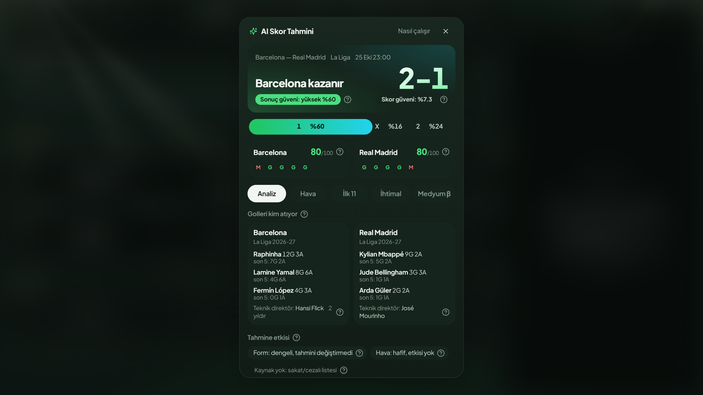
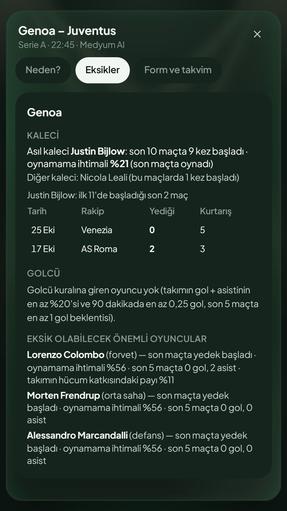
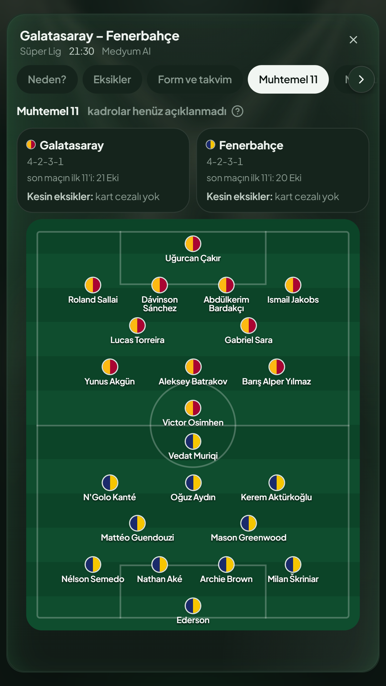
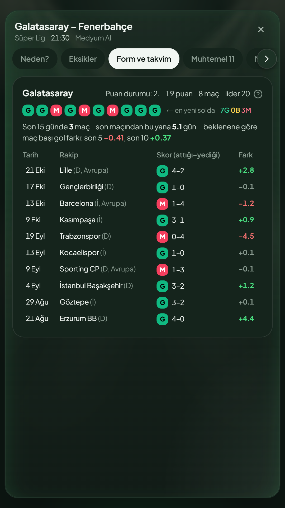
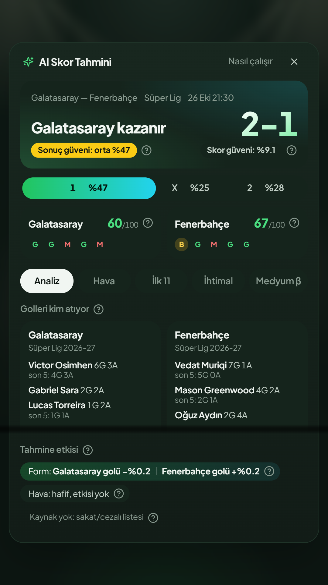
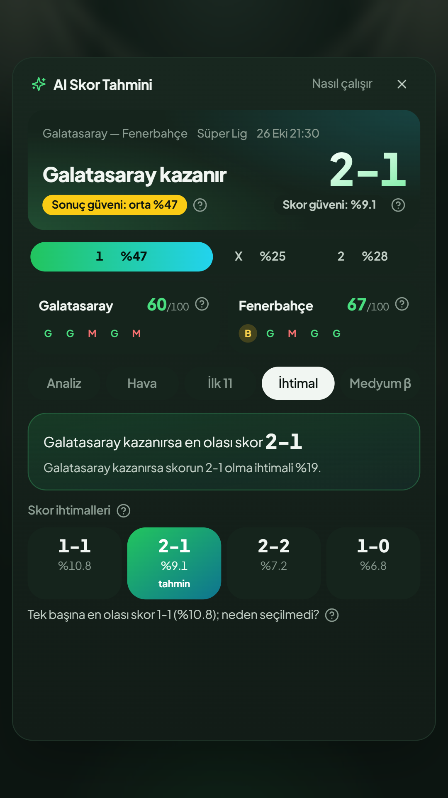
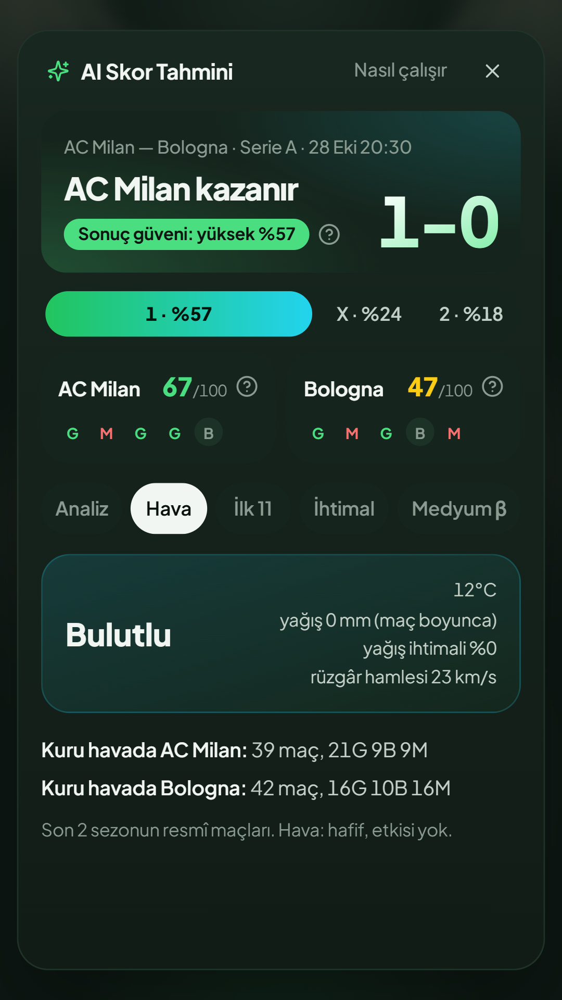
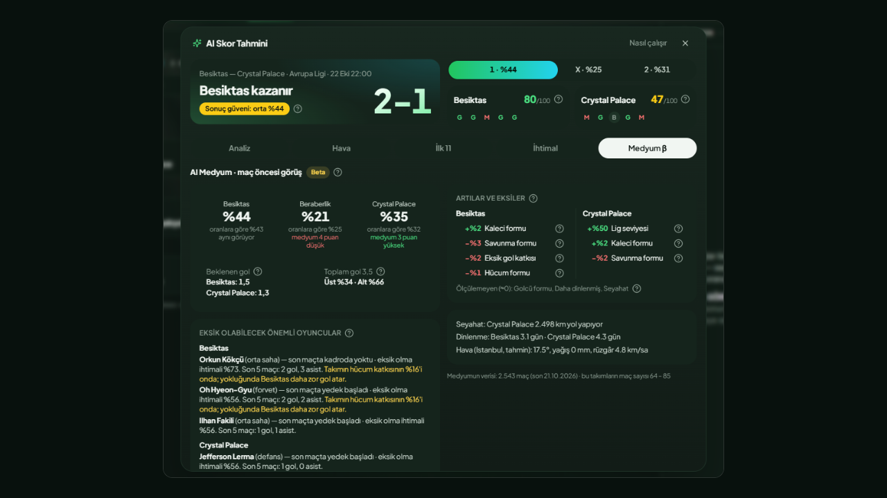

# Hi, I'm Berker

I work in product and data analytics and I build the products myself: a football match-intelligence tool with two forecasting models, a daily browser game and the automation that keeps a brand's channels running. I like taking an idea from a blank page to something people use every day, and I care about the parts that don't show on a screenshot: data quality, fair rules and numbers I can defend.

I build mostly in TypeScript and Node.js, with React and Next.js on the front end. I pair with Claude Code every day: I set the direction and the design, every feature ships with tests and a measurement script, and I check every result before it ships.

Open to product, data analytics and AI-automation roles in gaming, sports, tech and customer-experience operations.

  

---

## Macko: football match intelligence

One screen of evidence per match, two forecasting models you can audit, and a measurement loop that says how often they are right.

**The problem.** Pre-match information is scattered across a dozen sources, and most predictions can't say why they think what they think, or how often they turn out right.

**What Macko does.** It turns every match into a sourced match file and a forecast that explains itself. It runs daily on 100+ matches (European leagues, UEFA competitions, the NBA) with live, upcoming and finished views and a nine-day calendar. It shows probabilities and evidence, not advice: it is a personal research tool, not a public service.

<table>
  <tr>
    <td colspan="3" align="center"><b>The independent model</b> — Genoa vs Juventus: its own match file, built without market prices</td>
  </tr>
  <tr>
    <td width="33%" align="center"></td>
    <td width="33%" align="center"></td>
    <td width="33%" align="center"></td>
  </tr>
  <tr>
    <td align="center"><kbd>Absentees</kbd> Who is likely to be missing, with a probability learned from the past for each name</td>
    <td align="center"><kbd>Line-ups</kbd> Probable eleven of both teams, replaced by the real one as soon as it is announced</td>
    <td align="center"><kbd>Form & calendar</kbd> Last ten results, congestion and rest days, goals against expectation match by match</td>
  </tr>
  <tr>
    <td colspan="3" align="center"><b>The first model</b> — AC Milan vs Bologna: market consensus, adjusted and graded</td>
  </tr>
  <tr>
    <td width="33%" align="center"></td>
    <td width="33%" align="center"></td>
    <td width="33%" align="center"></td>
  </tr>
  <tr>
    <td align="center"><kbd>Analysis</kbd> Result and score with a confidence grade, who scores, and what moved the forecast</td>
    <td align="center"><kbd>Probabilities</kbd> The most likely score inside the chosen result, then the full score grid</td>
    <td align="center"><kbd>Weather</kbd> Kick-off forecast from Open-Meteo and how each team has done in that weather</td>
  </tr>
</table>

**What's inside**

- **A sourced match file.** Scorers and assists, the last five results, coach tenure, travel distance, rest days and kick-off weather. Where a source has nothing, it says "no data" instead of guessing.
- **An availability model.** Each player is placed in a class ("missed the last two matches", "suspended", "subbed off before half-time") and the model learns, from the past, how often each class actually sits out: 93% for "missed the last two", 82% for suspensions. The screen shows the name and the number.
- **Live match view.** Possession, shots, expected goals (xG and xGOT), big chances, PPDA and a pressure timeline as the game goes, plus line-ups as soon as they are announced. Mobile-first.
- **Two models side by side.** The first starts from the market consensus and adjusts it within tight caps for form, injuries and weather. The second is fully independent: a layered Poisson goal model trained week by week only on the past (5,113 detailed matches with line-ups, player stats, goal events and closing prices, plus 4,825 result-only rows across ten leagues since 2024-25), that never sees market prices and shows where it disagrees and why, factor by factor.

**Measured, not claimed**

- **The first model, backtested on 5,071 finished matches** (two full seasons and the current one, August 2024 to October 2026, ten leagues, closing prices): rebuilding the decision rule (pick the result first, then the most likely score inside it) took correct results from 51.1% to 55.0%, by a similar margin in every season (+3.8, +3.8 and +4.7 points), and cut "1-1" picks from 31% to 10%. The honest part: picking the market favourite gets 56.0% on the same matches, so the model does not beat the market on who wins; where it departs from the favourite it loses a little, and that rule is next on the list. What it adds is a confidence grade that means something: high-confidence calls are correct 70.0% of the time (n=1,948, 95% CI 68–72), medium 50.8%, low 37.7%. The old grade was upside down (its "high" was right 49.5% of the time, its "medium" 59.9%).

  | | Correct result | "High" grade correct | Log-loss (lower is better) |
  |---|---|---|---|
  | v1, old rule | 51.1% | 49.5% | 0.963 |
  | v2, current | **55.0%** | **70.0%** (n=1,948) | **0.953** |
  | Market favourite | 56.0% | — | 0.953 |

- **The independent model**, in a walk-forward backtest where each week is trained only on the past: no edge over the market yet (log-loss 0.984 against the market's 0.954 on 4,749 matches). The app says so on screen and keeps the model labelled beta until two to three months of live tracking say otherwise.
- **Live tracking since 16 October:** 947 forecasts recorded as they were made, 639 settled so far; across every league the app covers, 54.0% correct results (95% CI 50–58), high-confidence 64.9% (n=262), in line with the backtest.
- **A negative result, kept:** a rule-based variant built from my own football intuitions was tested the same way, with parameters frozen before the test. It lost to the data-driven model on 609 matches, and the write-up says which rule did the damage.

**Built to run unattended.** Request budgets, a circuit breaker and disk caches keep it up when a data feed fails; model training runs in a worker thread so the dashboard never freezes. Every model change re-runs the backtest before it ships.

`Next.js` `TypeScript` `Node.js worker threads` `Poisson and ridge regression` `walk-forward validation` `ESPN` `FotMob` `FPL` `Open-Meteo` `Wikidata`

## Kutubil: daily film trivia grid ([play it](https://oyna.kutubil.workers.dev))

**Built and shipped in under 24 hours:** first commit on a Saturday evening, live on Cloudflare the next afternoon with the data pipeline and online rooms working; automated backups and a guarded deploy followed the same evening.

A daily 3×3 grid for film fans: name an actor who fits both the row and the column. Film data comes from Wikidata and TMDB, gets cleaned into six catalogues (global, Turkish film and TV, Korean, Gen-Z and a mix) and a generator builds a new grid every night. You can also challenge a friend in a live room, and there is a playable-ad version of the game built for seven ad networks.

`React 19` `Vite` `TypeScript` `Cloudflare Workers` `D1` `Durable Objects`

## Firing XI: fantasy transfer league (in progress)

Managers build squads and play each other in a weekly league. I wrote the simulator before the game, because the hard part isn't the screens, it's making sure the rules give every manager a fair season. Every rule change runs through hundreds of simulated seasons and 500+ tests before it reaches the game. Mobile-first, with a pitch view, kit-style player cards and drag-and-drop line-ups. The repo is private for now; happy to walk anyone through it.

`Node.js` `JavaScript` `CSS` `Headless browser testing`

---

## AI-powered automation and brand systems

I build automation that takes repetitive work off people's plates: agents that research and write, pipelines that collect, clean and score data, and template systems that keep every output on-brand. Some examples:

- **Job-market pipeline.** Collects new listings twice a day, scores each one against my CV with a rule layer plus an LLM rubric (with an audit that checked the rubric's reasons against the listing text: 97–100% grounded, zero invented claims), pushes the results to a Google Sheet and runs unattended on Windows Task Scheduler with a health check and a desktop alert when something breaks.
- **Brand systems in Claude Design.** For Firing XI I designed the whole identity on a Claude Design canvas: logo, colour and type tokens and ready-made templates for posts, stories and thumbnails. All of them read from one tokens file, so a new post comes out on-brand without being redesigned and the game's interface uses the same file.
- **Social content agent** for a football game's accounts. It learns the brand's voice from past posts, plans a week of varied ideas across content pillars and writes a ready-to-use image prompt for each, with automated checks against the brand rules.
- **Football news content engine.** Headline in, fact-checked Instagram carousel plus captions for Instagram and X out. Slides are rendered from HTML templates, so Turkish characters always come out right.
- **Daily AI news digest.** Collects Claude and Anthropic news every morning, summarizes it in Turkish and adds a new page to a Google Slides "magazine" with a linked table of contents.

## Also built

- **Match highlight simulation:** turns raw player-tracking data into an animated 2D highlight reel, plus a clip list analysts can filter in Excel.
- **Tek Taht:** a strategy game prototype with design documents, 47 SVG sprites and a playable single-file build.
- **Studio work** on a football management game: parts of the playable prototype (React, Vite, Playwright) and the landing page (Next.js).
- A car-rental website for a client and a small generative-visuals tool for Reels.
